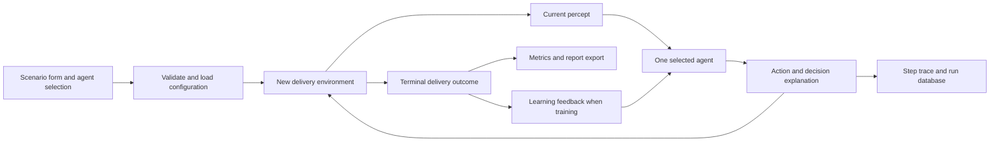
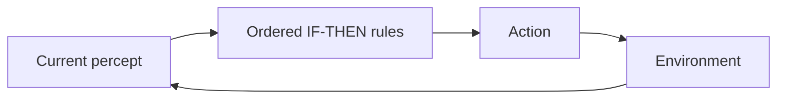
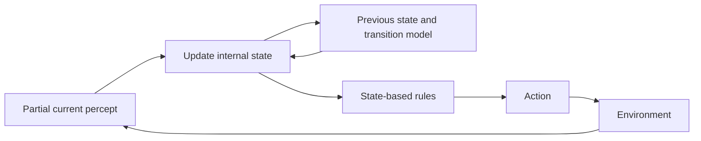
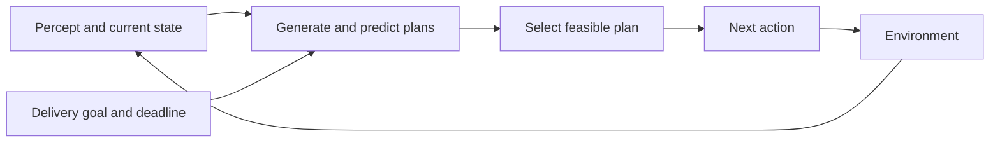
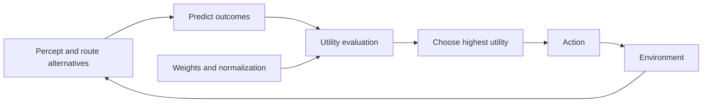
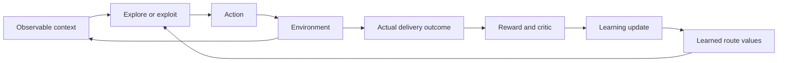
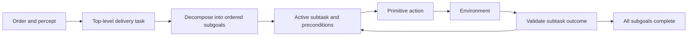
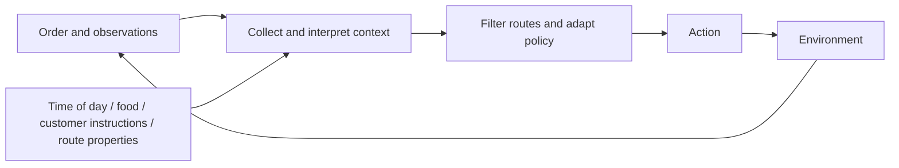

# Smart Food Delivery: implementation plan for seven independent agents

This is the seven-agent design and build plan. The accompanying implementation is now built; see README.md for execution and report/COMPARISON.md for measured results. The target is a fully working local application that demonstrates all seven architectures separately, completes simulated deliveries, and produces the assignment comparison evidence.

## 1. Scope and assignment requirements

Source: [Assignment PDF](<D:/Desktop/UCP/7th semester/Agent Based Modeling/Assignments/Assignment 1/Assignment_1.pdf>), pages 1-2.

The assignment requires a common food-delivery scenario, agent implementations, one architecture diagram per agent, results for three common situations, a behavior comparison, and a conclusion. Its listed deadline is 11 October 2026. It describes independent single agents; multi-agent systems are not required.

The source mixes six and seven agents. The user explicitly requested all seven, so this implementation includes Simple Reflex, Model-Based Reflex, Goal-Based, Utility-Based, Learning, Hierarchical, and Contextual as first-class independent agents.

Implementation choices below are proposed designs, not additional instructions from the PDF. A local simulated environment is the assumed target. Real orders, live rider tracking, restaurant integration, and payments belong to a separate operational deployment scope.

## 2. Recommended technology stack

| Component | Choice | Purpose |
|---|---|---|
| Language | Python 3.12 | Agent logic, simulation, persistence, and tests |
| Interactive application | Streamlit | Agent selection, scenario forms, step controls, traces, charts, downloads |
| Agent architectures | Plain Python classes | Keep each architecture explicit and explainable during viva |
| Models and configuration | dataclasses, enum, JSON | Shared contracts and reproducible scenario definitions |
| Database | SQLite through sqlite3 | Save runs, steps, decisions, outcomes, training history, learned values |
| Result tables | pandas | Compare and export results |
| Diagrams | Mermaid source plus exported SVG/PNG | Seven architecture diagrams and common application flow |
| Charts | Streamlit chart components | Delivery-time, cost, lateness, and learning progress charts |
| Tests | pytest | Architecture behavior, simulator correctness, and shared scenario matrix |
| Environment | venv and pip | Isolated dependencies and reproducible installation |
| Version control | Git | Track code, configuration, and documentation |

Only Streamlit, pandas, and pytest need to be listed as direct third-party Python dependencies for this baseline. Pin the exact versions after installation and verification. SQLite, JSON, dataclasses, and random are available through the standard Python distribution used for the project; verify sqlite3 is present during setup.

An LLM API, LangChain, CrewAI, a vector database, separate React frontend, cloud server, and GPU are unnecessary for these proposed algorithms. The learning implementation uses a small tabular method. A laptop and browser are sufficient; reserve roughly 1 GB of free disk space for the environment and artifacts as a practical planning allowance. Internet is needed for installation, but the completed local demonstration should work offline.

Documentation used to verify setup choices:

- [Streamlit installation and supported Python versions](https://docs.streamlit.io/get-started/installation/command-line)
- [Streamlit session state](https://docs.streamlit.io/develop/api-reference/caching-and-state/st.session_state)
- [Python SQLite interface](https://docs.python.org/3/library/sqlite3.html)
- [Python virtual environments](https://docs.python.org/3/library/venv.html)
- [pytest parameterized tests](https://docs.pytest.org/en/stable/how-to/parametrize.html)

## 3. Shared application architecture



Each agent controls its own copy of the environment. A comparison runner creates seven separate runs from identical scenario configuration. Agents do not message one another or share mutable delivery state.

The dashboard and database may record complete traces, but only the model-based, goal-based, utility-based, learning, and hierarchical agents receive the memory their architecture requires. The simple reflex decision function receives the current percept only.

### Shared data contracts

| Model | Required fields |
|---|---|
| Order | order_id, restaurant, customer, deadline_min, urgency, status |
| Route | route_id, distance_km, base_travel_min, traffic_multiplier, base_cost, available |
| Scenario | scenario_id, order, routes, weather, weather_multiplier, event_schedule, seed, noise_mode |
| Percept | simulation_time, order_status, current_location, current_route, visible_route_observations, weather, pickup_ready |
| Action | action_type, optional route_id, optional duration_min |
| Decision | action, reason, architecture_evidence |
| Outcome | terminal_status, actual_duration_min, cost, distance, deadline_met, lateness_min, failure_reason |
| TraceEvent | run_id, step, simulation_time, percept, decision, state_before, state_after |

Use enums for statuses and action types. Validate nonnegative distances/costs, positive durations and multipliers, valid route IDs, valid weather labels, and event times. Treat an unobserved traffic value as unknown, distinct from light traffic.

### Common action interface

Every agent exposes `reset(config)`, `decide(percept) -> Decision`, and a read-only debug snapshot. The learning agent additionally exposes `observe_outcome(outcome)` and policy save/load methods.

Actions: ACCEPT_ORDER, SELECT_ROUTE, PICK_UP, MOVE, WAIT, REROUTE, CONFIRM_DELIVERY, REPORT_FAILURE. The environment validates action preconditions. CONFIRM_DELIVERY requires the customer location and completed pickup. Illegal actions create explicit errors rather than silently delivering the order.

### Simulator behavior

Use a discrete-time environment with one-minute MOVE/WAIT steps and explicit lifecycle transitions:

`PLACED -> ACCEPTED -> ROUTE_SELECTED -> PICKED_UP -> IN_TRANSIT -> ARRIVED -> DELIVERED`

Terminal alternatives are FAILED and TIMED_OUT. Choosing a route before pickup follows the assignment's example hierarchy; it is allowed but can be revised before departure.

1. ACCEPT_ORDER changes status and records acceptance.
2. SELECT_ROUTE validates availability and records a route.
3. PICK_UP consumes the remaining preparation/handling time; if food is not ready, the agent must WAIT.
4. MOVE advances position on the selected route and simulation time.
5. Scheduled traffic, weather, and closure events update the world between steps.
6. REROUTE is permitted only at configured junctions; compute remaining travel from that junction and retain time, distance, and cost already incurred.
7. At arrival, CONFIRM_DELIVERY consumes dropoff time and finalizes the outcome.
8. A maximum simulated duration and maximum action count terminate unproductive loops.

For the initial static scenarios, use:

`estimated_total_min = remaining_pickup_min + base_travel_min * traffic_multiplier * weather_multiplier + dropoff_min`

Use a five-minute pickup/handling allowance and two-minute dropoff allowance in the example fixtures. These are illustrative simulation parameters, not real traffic estimates. Traffic already affects ETA, so explain that a separate congestion utility term expresses an additional preference and can overlap with time.

Keep environment truth separate from agent predictions. In deterministic mode they may match. In learning experiments, sample small bounded travel variation using a seed and pre-generated route-specific conditions. Agents cannot read future realized delays. A shared scenario seed alone is insufficient if each agent consumes random draws differently; generate the exogenous conditions before running the agents.

### Persistence

Create tables:

- `runs`: run_id, agent_type, scenario_id, config_json, seed, policy_version, training_mode, terminal_status.
- `steps`: run_id, step_no, simulation_time, percept_json, decision_json, state_json.
- `outcomes`: run_id, actual_time, total_cost, distance, lateness, delivered, deadline_met.
- `learning_values`: policy_version, context_key, route_id, sample_count, mean_reward.
- `training_episodes`: policy_version, episode_no, scenario_id, route_id, reward, outcome_json.

Use parameterized SQL and transactions. The UI should persist the active run in Streamlit session state between reruns and save finalized outcomes to SQLite. Button reruns must not duplicate steps or apply a learning update twice; assign unique run and step IDs and enforce uniqueness.

## 4. Agent 1: Simple Reflex

### End-to-end workflow

Order and current observations arrive -> match the first applicable IF-THEN rule -> return one action -> simulator executes it -> receive the next current observation -> repeat until terminal -> save the delivery result.

Use lifecycle rules to accept, pick up, move, and confirm. For routing, use an explicitly ordered policy:

1. If no route is available, report failure.
2. If the default route has heavy traffic, choose the first available non-heavy route in configured priority order.
3. Otherwise choose the default available route.
4. If all alternatives are heavy, use the first available route and record the fallback rule.

Rain can trigger a fixed rule such as selecting a predefined rain-compatible route when available. State the precedence so traffic and rain rules do not conflict. Rules must depend only on current observations and fixed configuration; no delivery history, route scoring, or stored beliefs.



UI evidence: current traffic/weather, matched rule ID, route action, delivery timeline, final time/cost. A changed earlier observation must not affect a later decision when the current percept is identical. For a missing required observation, use a documented wait/fallback rule rather than remembered information.

Implementation module: `agents/simple_reflex.py`. Completion criterion: the action is explainable by one displayed rule, and the agent stores no changing decision memory.

## 5. Agent 2: Model-Based Reflex

### End-to-end workflow

Receive observation -> merge it with internal state and the last action using a transition model -> update beliefs -> apply state-based IF-THEN rules -> execute action -> update state at the next observation -> complete delivery -> record state history.

Internal state includes current route, believed traffic per route, weather, location, pickup status, delivery status, last action, and timestamps for observations. Missing observations retain prior beliefs until a configured staleness limit; after that, mark them unknown. This architecture still selects actions through rules, rather than optimizing a goal or utility.



Demonstration: observe heavy traffic on Route A, then temporarily hide that sensor. The model-based agent still knows its last observed condition; the simple reflex agent follows its unknown-input rule. Later, inject a closure at a junction and show the belief update and reroute.

UI evidence: side-by-side current percept and internal state, timestamps, state changes, matched rule, and reroute reason.

Implementation module: `agents/model_based.py`. Completion criterion: a multi-step trace demonstrates retained information and valid state transitions, with no state leakage between independent runs.

## 6. Agent 3: Goal-Based

### End-to-end workflow

Receive order and deadline -> define the goal -> represent the current delivery state -> enumerate candidate delivery plans -> predict completion times -> select a plan satisfying the goal -> execute its next action -> monitor/replan when observations invalidate the plan -> confirm whether the goal was achieved.

Define the goal as `delivered == True AND total_elapsed_min <= deadline_min`. Generate plans such as accept -> select route -> wait if necessary -> pick up -> traverse route -> confirm. For three whole-route candidates, explicit enumeration is enough. If a later version represents a road graph, add a shortest-path search.

Select a deadline-feasible plan using a fixed route-ID tie-break. That makes feasibility the primary criterion. If none can meet the deadline, report that the goal is infeasible and select the fastest available fallback to complete delivery if possible. Never label a late fallback as goal success.



UI evidence: explicit goal, each candidate's predicted completion, feasible/infeasible flag, chosen plan, and remaining plan steps. Replanning must use remaining time, including pickup and dropoff, rather than reset the deadline.

Implementation module: `agents/goal_based.py`. Completion criterion: urgent scenarios trigger explicit deadline reasoning, and impossible deadlines are reported honestly.

## 7. Agent 4: Utility-Based

### End-to-end workflow

Receive candidate routes and conditions -> predict route outcomes -> normalize time, cost, distance, and congestion -> compute utility for every valid route -> choose maximum utility -> execute delivery actions -> recompute at allowed decision points when conditions change -> record the realized outcome and score components.

Suggested configurable score:

`U(route) = -(wt * ETA/45 + wc * cost/200 + wd * distance/10 + wg * traffic_multiplier/3) - 2 * max(0, ETA-deadline)/45`

The denominators are fixed reference scales for this demonstration, not clipping thresholds or physical limits. Using fixed scales makes scores comparable across runs. Baseline weights: time 0.45, cost 0.25, distance 0.15, congestion 0.15. For urgent delivery, use time 0.60, cost 0.15, distance 0.10, congestion 0.15. These are proposed preferences that should be visible and justified in the report.

Exclude closed/unavailable routes before scoring. Use a stable route-ID tie-break. At a reroute junction, use predicted total outcomes, including sunk time/cost and switch overhead; never treat the entire original journey as still remaining.



UI evidence: score table containing raw inputs, normalized terms, lateness penalty, total score, and selected route. Include weight controls so the viva can demonstrate how preferences affect decisions.

Implementation module: `agents/utility_based.py`. Completion criterion: the displayed winner matches the computed maximum, and a controlled weight change can change selection when a genuine tradeoff exists.

## 8. Agent 5: Learning

### End-to-end workflow

Load learned values or initialize a fresh policy -> build a context key from observable conditions -> choose a route through exploration or exploitation -> run the delivery -> compute reward from actual time/cost/lateness -> update the chosen route's value -> persist it -> show how later decisions differ -> evaluate a frozen trained policy on separate runs.

Use a contextual tabular bandit for route choice and fixed lifecycle rules for accepting, picking up, moving, and confirming. Context key: weather category, overall congestion category, and urgency. Store count and mean reward for each `(context, route)` pair.

Training policy: explore unseen routes first; subsequently use epsilon-greedy selection with a configurable epsilon such as 0.10. Exploitation chooses the highest learned mean reward. Learning update:

`count <- count + 1`

`Q(context, route) <- Q(context, route) + (reward - Q(context, route))/count`

Reward uses the utility formula from Agent 4 with actual outcomes instead of predictions, with an additional explicit failure penalty such as -5. This aligns learned preferences with a documented objective. The formula and penalty must be saved with the policy version.



Start with roughly 180 training episodes: 20 exploratory samples for each of three routes across three scenario contexts, then optional epsilon-greedy episodes. This is a starting budget, not a guarantee of statistical convergence. Use different seeds for held-out evaluation; evaluation disables exploration and updates. Save both an untrained policy snapshot and a trained snapshot.

UI controls: Reset Learning, Train N Episodes, Freeze Policy, Evaluate Policy. Show action counts, Q values, actual rewards, training reward trend, and held-out results. Persist learned values across restarts, but isolate training from the main comparison run.

Implementation modules: `agents/learning.py`, `training.py`, and persistence helpers. Completion criterion: feedback changes learned values, values survive restart, and the report measures cold-start versus trained behavior without assuming training always improves every run.

## 9. Agent 6: Hierarchical

### End-to-end workflow

Receive the top-level delivery task -> decompose it into subgoals -> activate the next subgoal -> run its subroutine -> validate completion -> advance the task stack -> recover/replan on failure -> finish confirmation -> report parent-task success.

Use a small hierarchical task network or explicit task stack:

1. AcceptOrder: require PLACED, produce ACCEPTED.
2. ChooseRoute: require an accepted order and available routes, produce ROUTE_SELECTED.
3. PickUpFood: require a chosen route; wait until food is ready, then produce PICKED_UP.
4. DeliverOrder: move through route segments; a blockage creates a FindAlternativeRoute subtask.
5. ConfirmDelivery: require ARRIVED and possession of food, produce DELIVERED.

Define route selection within ChooseRoute as the fastest predicted available route. This is a documented subroutine; the architecture's distinctive behavior is goal decomposition, dependencies, and task recovery, not a claim that hierarchy alone yields a superior route.



UI evidence: task tree, active subgoal, preconditions, completed steps, failed step, and recovery task. Demonstrate delayed food preparation to show PickUpFood waiting without allowing delivery to begin prematurely.

Implementation module: `agents/hierarchical.py`. Completion criterion: all dependencies are enforced and task recovery is visible in the trace.

## 9A. Agent 7: Contextual

### End-to-end workflow

Collect order and contextual signals -> validate context -> filter eligible routes -> adapt selection to service needs -> execute the next action -> reevaluate context at junctions -> confirm delivery -> record which contextual factors affected the result.

Inputs include time of day, food type (standard/hot/frozen), customer preference (balanced/economy/fastest), route lighting, flood risk, and restaurant backlog. At night, exclude unlit routes. During rain, exclude routes with flood risk >= 0.7. If no route meets these explicit safety constraints, report failure. For nonurgent standard food with economy preference, choose the cheapest eligible route; otherwise choose the fastest eligible route. Hot/frozen food therefore prioritizes prompt delivery over an economy preference.

Restaurant backlog changes pickup readiness for all agents because it is a property of the shared environment. Contextual architecture is additionally distinguished by context-dependent eligibility and preference rules.



UI evidence: collected context, applied filters, eligible routes, predicted completion, action, and complete outcome. Demonstrate X4 and compare day versus night using identical route data.

Implementation module: `agents/contextual.py`. Completion criterion: changing only contextual inputs can change route selection, and the decision evidence identifies the responsible condition.

## 10. Dashboard and demonstration flow

Provide one landing screen and seven dedicated agent views or tabs. The same reusable UI renders agent-specific evidence.

Every agent view contains:

1. Scenario selector: the three required presets plus a custom scenario form.
2. Input panel: order, deadline, traffic, weather, routes, costs, and distances.
3. Architecture diagram.
4. Run, Step, Reset, and Replay controls. Automated runs can generate the trace first, then replay it without re-executing decisions or learning updates.
5. Delivery visualization: a small schematic restaurant-to-customer route drawing, current progress, and status timeline.
6. Decision panel: actual matched rule, belief update, candidate plan, utility table, learned value, or task stack. Generate this explanation directly from the executed code.
7. Outcome panel: delivered status, deadline result, elapsed time, distance, cost, reroutes, waits, and errors.
8. Download buttons for trace JSON and results CSV.

A separate Comparison screen runs all seven against cloned fixtures, shows 21 baseline outcomes, and exports the comparison table. A History screen reloads previous runs and policy versions. UI session state holds active objects across reruns; SQLite holds durable records across app restarts.

## 11. Required common scenarios

The following are proposed synthetic fixtures. Expected times below are deterministic simulator calculations, not measured implementation results.

| Route | Distance | Base travel | Cost | Priority |
|---|---:|---:|---:|---:|
| A | 5 km | 10 min | 100 cost units | 1 |
| B | 8 km | 16 min | 150 cost units | 2 |
| C | 6 km | 12 min | 120 cost units | 3 |

| Scenario | Traffic multipliers A/B/C | Weather multiplier | Deadline | Predicted totals A/B/C |
|---|---|---:|---:|---|
| S1: normal traffic, good weather | 1.0 / 1.0 / 1.0 | 1.0 | 35 min | 17 / 23 / 19 min |
| S2: heavy traffic, multiple routes | 2.2 / 1.1 / 1.3 | 1.0 | 35 min | 29 / 24.6 / 22.6 min |
| S3: heavy traffic, rain, urgent | 2.2 / 1.1 / 1.3 | 1.25 | 28 min | 34.5 / 29 / 26.5 min |

Give routes explicit traffic labels consistent with these fixtures: A heavy in S2/S3, B light, C moderate. The simple reflex agent's first non-heavy alternative is B. In S3 only C is predicted to meet the deadline. A goal-aware or utility-aware agent can therefore differ from that rule policy. The exact outcome still depends on the final documented policy and simulator.

Discrete steps must preserve fractional travel times by consuming a fractional final MOVE step or storing higher-resolution time; otherwise these expected totals will be rounded. Pick one convention and use it consistently.

Keep all three required presets static for the baseline comparison. Add supplementary experiments rather than replace them:

- Partial observation to reveal model-based memory.
- Mid-delivery closure at a junction to test rerouting.
- Delayed restaurant preparation to reveal hierarchy dependencies.
- Impossible deadline and no available routes to verify truthful failure handling.
- Seeded repeated deliveries to reveal learning.
- A cheap slower route versus an expensive faster route to reveal utility tradeoffs.

Different architectures may legitimately choose the same route. The comparison should show how they arrived at their decisions, not force artificial differences.

## 12. Tests, evaluation, and acceptance criteria

Run a parameterized matrix of seven agents and three common scenarios: at least 21 baseline delivery runs. Add meaningful architecture-specific tests:

| Area | Required check |
|---|---|
| Environment | No confirmation before pickup/arrival; ETA formula includes handling; terminal timeout prevents loops |
| Reflex | Identical current percept yields identical decision regardless of earlier history |
| Model-based | Missing observation retains a valid recent belief; reset clears state; stale belief becomes unknown |
| Goal-based | Deadline-feasible plan selected when one exists; impossible goal flagged |
| Utility-based | Highest computed utility wins; stable tie-break; closed routes excluded |
| Learning | Known reward updates Q correctly; save/load preserves values; frozen evaluation cannot update policy |
| Hierarchical | Subtask ordering enforced; waiting and recovery work; parent task cannot finish early |
| UI/persistence | Step button performs exactly one action; replay has no side effects; finalized outcomes saved once |
| Comparison | Separate states and identical pre-generated environmental conditions; policy versions recorded |

Record delivery completion rate, deadline success rate, lateness, actual time, cost, distance, reroutes, and number of decisions. Show utility scores only with their formula/version; do not treat an agent's own utility as an unbiased universal ranking.

Three scenarios provide assignment evidence, not a broad statistical benchmark. If making claims about learning improvement or average performance, run repeated held-out seeded deliveries and report the number of runs and variation. Compare under the same external metric and conditions.

Complete means: all seven finish or report a valid terminal failure; inputs can be changed; architecture-specific reasoning is visible; learning is persistent; all required results and diagrams export; installation from the README works; automated checks pass; and the application can be demonstrated offline after dependencies are installed.

## 13. Proposed repository layout

```text
smart_food_delivery/
  app.py
  cli.py
  requirements.txt
  README.md
  core/
    models.py
    environment.py
    metrics.py
    runner.py
    storage.py
  agents/
    base.py
    simple_reflex.py
    model_based.py
    goal_based.py
    utility_based.py
    learning.py
    hierarchical.py
    contextual.py
  ui/
    agent_view.py
    comparison_view.py
    learning_view.py
  data/
    scenarios.json
    events.json
    delivery.db
  diagrams/
    simple_reflex.mmd
    model_based.mmd
    goal_based.mmd
    utility_based.mmd
    learning.mmd
    hierarchical.mmd
  tests/
    test_environment.py
    test_agents.py
    test_learning.py
    test_comparison.py
  outputs/
    results.csv
    traces/
    screenshots/
    diagrams/
  report/
    comparison.md
    conclusion.md
```

The accompanying repository implements this structure, with shared UI code in app.py and reusable architecture evidence in the agent modules. Keep generated databases, virtual environments, and caches out of Git; track scenario definitions and a clean learning-policy seed if required for reproducibility.

## 14. Implementation sequence and estimated effort

These were initial rough focused-work estimates for someone comfortable with Python. Revisions and unfamiliarity can increase them.

| Phase | Work | Deliverable | Estimate |
|---|---|---|---|
| 1 | Contracts, scenarios, validation, environment | Delivery can run without a UI | 2-3 hours |
| 2 | Reflex and model-based policies | Rules and memory demonstrated | 1-2 hours |
| 3 | Goal and utility policies | Plans and scores demonstrated | 2-3 hours |
| 4 | Hierarchical task execution | Ordered subgoals and recovery | 1-2 hours |
| 5 | Learning, reward, training, persistence | Train/save/load/frozen evaluation | 2-3 hours |
| 6 | Dashboard and exports | Seven demos plus comparison/history | 2-3 hours |
| 7 | Tests, diagrams, screenshots, report | Verified submission package | 2-3 hours |

Total planning allowance: approximately 12-19 focused hours. With the assignment deadline on 11 October 2026, prioritize the simulator, clear traces, 21 common runs, and diagrams before cosmetic polish or optional integrations. Build and verify agent behavior through a CLI before connecting it to Streamlit.

## 15. Planned installation and run commands

Run these Windows PowerShell commands from the project folder:

```powershell
py -3.12 -m venv .venv
.\.venv\Scripts\python.exe -m pip install -r requirements.txt
.\.venv\Scripts\python.exe -m pytest -q
.\.venv\Scripts\python.exe cli.py compare --scenarios data/scenarios.json --output outputs/results.csv
.\.venv\Scripts\python.exe -m streamlit run app.py
```

The CLI comparison, training, reset-learning, and individual-run commands are implemented. Calling the virtual environment's Python directly avoids depending on PowerShell activation policy. Initial direct dependencies: streamlit, pandas, pytest; create a pinned requirements file after a working installation is verified.

Provide a fresh-start operation that clears run state while preserving trained policies, and a separate explicit Reset Learning operation. Set database and output paths relative to the application root, create missing writable folders, and show actionable errors if persistence fails.

For an optional hosted class demo, package the same app and dependencies, choose hosting with durable storage, and verify where policy/database files survive restarts. A local SQLite file on ephemeral hosting is not durable persistence. The local version is the required baseline.

## 16. Submission and viva package

Deliver implementation source, pinned requirements, README with setup/demo commands, three scenario fixtures, seven diagrams, 21 baseline outcomes, trace screenshots, learning before/after evidence, behavior comparison, and a conclusion tied to actual results.

The PDF's submission instructions include a title page with course, assignment number, student names and full registration numbers, section, and instructor name, and submission through the portal. Those details are source requirements for a later submission document; the present request is for a plan.

During the demo, show S1, S2, and S3 for each agent; then show the supplementary memory, utility, hierarchy, and learning experiments. Explain why the same final route can still arise from different architectures.

A reasonable initial hypothesis is that utility-based selection suits this scenario's simultaneous time/cost/distance preferences, while learning may improve choices when the environment's delay patterns are imperfectly known. Choose the final conclusion after measured results; do not predetermine a winning architecture.

## 17. Real-world operation beyond the assignment

For operational food delivery, first retain the tested agents behind replaceable environment adapters. A later build would require route/traffic and weather providers, verified location input, an order source, rider/customer interfaces, delivery confirmation, authentication, durable centralized storage, background execution, network-failure handling, and audit/monitoring. Define API credentials, provider quotas, data contracts, refresh intervals, stale-data handling, and recurring costs before selecting providers. Any payment or notification flow needs an explicit product requirement. These integrations are additional work beyond the local assignment simulator.

## Implementation status

All seven agents, simulator, Streamlit dashboard, SQLite persistence, training/evaluation, diagrams, CLI, common/supplementary fixtures, and automated tests are implemented in this folder. Generated result CSVs and full traces are under outputs/. Dependencies are installed in .venv and pinned in requirements-lock.txt. Start with start.ps1 or the README command. Final verification counts and observations are recorded in report/COMPARISON.md.
